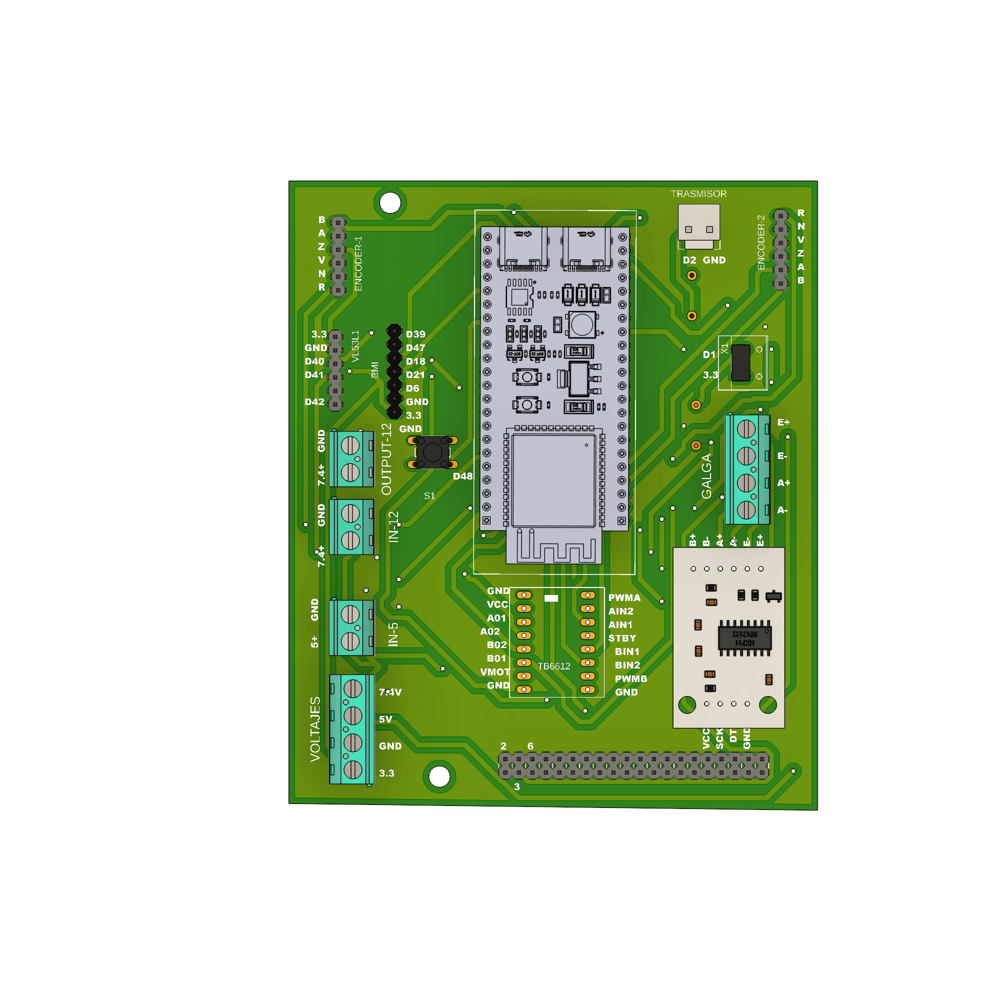

# 🟩 Diseño de la PCB

Placa de circuito impreso propia de M.A.V.I., que integra en una sola tarjeta la distribución de potencia, el control de los motores y la conexión de los sensores.

&nbsp;&nbsp;

Vista superior e inferior del modelo 3D

---

### 👁️ Visualización

 **MAVI_PCB_DISENO.pdf**
Plano de la placa con las pistas de cobre y la ubicación de cada componente. Visualización directa en GitHub.

 **MAVI_PCB_3D_SUPERIOR.png** · **MAVI_PCB_3D_INFERIOR.png**
Vistas del modelo tridimensional de la placa. Visualización directa en GitHub.

---

### 🛠️ Archivos editables

 **MAVI_PCB_DISENO.fbrd**
Diseño original de la placa en Autodesk Fusion 360. Requiere descarga para su consulta o modificación.

 **MAVI_PCB_DISENO.brd**
Diseño exportado al formato Eagle, compatible con otros programas de diseño electrónico, como KiCad. Requiere descarga.

 **MAVI_PCB_3D.step**
Modelo 3D en formato estándar de intercambio CAD, utilizado para integrar la placa en el ensamble mecánico del vehículo. Se abre con Fusion 360, FreeCAD u otro software CAD.

---

<a href="../README.md">⬅️ Volver a Diseño electrónico</a>

