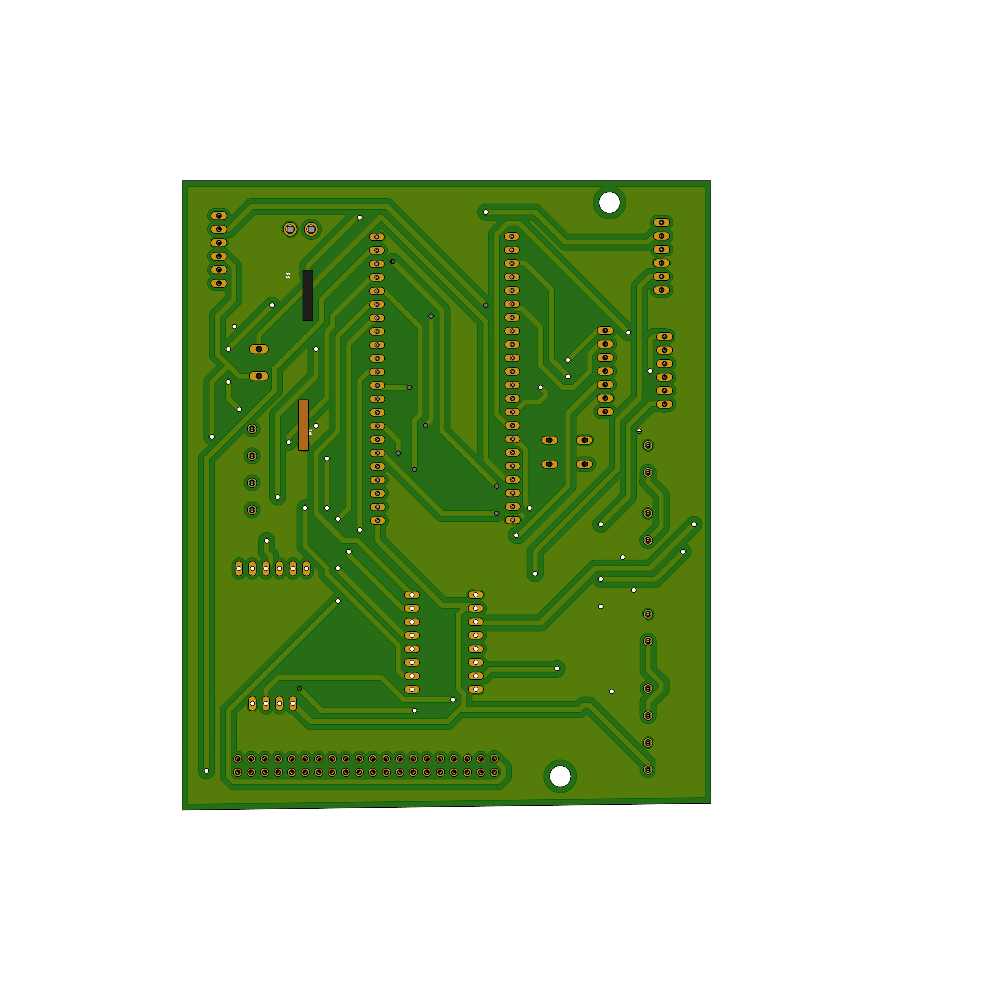

# 🟩 Diseño de la PCB

Placa de circuito impreso propia de M.A.V.I., que integra en una sola tarjeta la distribución de potencia, el control de los motores y la conexión de los sensores.

**2 capas · 1.6 mm de grosor · 99.45 × 118.35 mm**

&nbsp;&nbsp;

Vista superior e inferior del modelo 3D

---

### 👁️ Visualización

 **MAVI_PCB_DISENO.pdf**

Plano de la placa en una hoja tamaño A3, en el que se superponen las dos capas de cobre: la superior en rojo y la inferior en azul. Muestra el recorrido de las pistas, la ubicación de cada componente y las serigrafías que identifican borneras, conectores y pines. Es la referencia para revisar el diseño, verificar conexiones o guiar el proceso de soldadura. Se visualiza directamente en GitHub.

 **MAVI_PCB_3D_SUPERIOR.png** · **MAVI_PCB_3D_INFERIOR.png**

Imágenes renderizadas del modelo 3D de la placa. La vista superior muestra los componentes montados: la ESP32-S3, el módulo HX711, el driver TB6612FNG, las borneras y los conectores de sensores y encoders. La vista inferior muestra la cara posterior, donde se ubican las dos resistencias del circuito. Las imágenes presentan la placa en color verde por defecto del render; la placa fabricada tiene máscara negra. Se visualizan directamente en GitHub.

---

### 🛠️ Archivos editables

 **MAVI_PCB_DISENO.fbrd**

Archivo original del diseño de la placa, creado en Autodesk Fusion 360. Contiene toda la información editable: el trazado de las pistas, las dos capas de cobre, la posición de los componentes y las reglas de diseño. Es el archivo que se debe utilizar para realizar cualquier modificación o una nueva versión de la placa. Requiere descarga y se abre con Fusion 360.

 **MAVI_PCB_DISENO.brd**

Copia del diseño de la placa exportada al formato de Autodesk Eagle, uno de los más utilizados en diseño electrónico. Su finalidad es que el diseño pueda abrirse en programas distintos a Fusion 360; por ejemplo, KiCad, software gratuito de diseño de circuitos, permite importarlo. Requiere descarga.

 **MAVI_PCB_3D.step**

Modelo tridimensional de la placa en formato STEP, el estándar para intercambiar modelos entre programas CAD. Conserva las dimensiones reales de la PCB y sus componentes, por lo que se utiliza para integrarla en el ensamble mecánico del vehículo y verificar que encaje correctamente en el chasis. Requiere descarga y se abre con Fusion 360, FreeCAD u otro software CAD.

---

<a href="../README.md">⬅️ Volver a Diseño electrónico</a>

