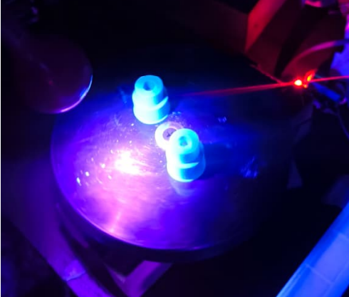
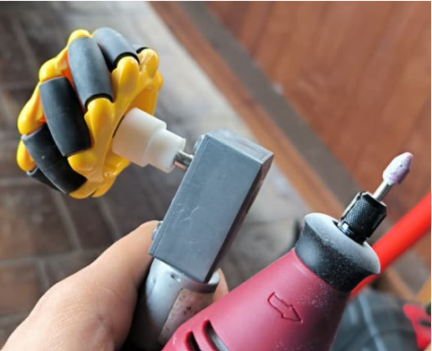

# 📸 Galería de Evidencias Fotográficas — Semana 8

*Registro técnico de pruebas de laboratorio, prototipado 3D e integración del subsistema electrónico y de tracción de M.A.V.I.*

---

### 1. ⚡ Banco de Pruebas Electrónico
> **Componentes:** ESP32-S3 · Driver TB6612FNG · Fuente de alimentación (5.1V @ 2A)

*Montaje de laboratorio para la validación de señales PWM, protocolo de comunicación y comportamiento térmico del driver de potencia.*

---

### 2. 🖨️ Fabricación de Acoples en Resina (SLA)
> **Proceso:** Impresión 3D en resina fotopolimérica / Curado UV

*Prototipado rápido de adaptadores a medida para la interfaz entre los ejes de los motorreductores y las ruedas Mecanum.*

---

### 3. 🛠️ Ajuste Mecánico de Tolerancias
> **Herramienta:** Dremel / Mototool de precisión

*Rectificado de tolerancia dimensional en el acople impreso para garantizar concentricidad y minimizar holgura mecánica.*

---

### 4. ⚙️ Adaptadores y Ruedas Mecanum
> **Componentes:** Ruedas omnidireccionales + Acoples impresos

*Integración física de las ruedas Mecanum con los adaptadores terminados antes de su montaje en los motores.*

---

### 5. 🔍 Par de Motorreductores y Tracción
> **Vista:** Superior / Simetría de actuadores

*Vista superior de la alineación y simetría del par de motorreductores ensamblados con sus respectivas ruedas de prueba.*

---

### 6. 🚚 Chasis Provisional de Locomoción
> **Estructura:** Base provisional de madera · Montaje de tracción diferencial

*Estructura provisional ensamblada para la ejecución de pruebas dinámicas de trayectoria, viraje y compensación de velocidad por software.*

---

[⬅️ Volver a Diseño Electrónico](../README.md)