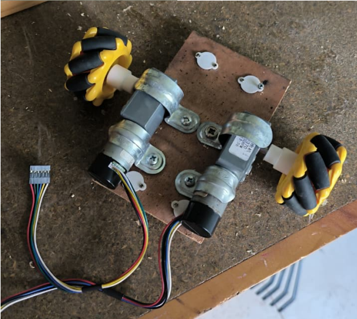
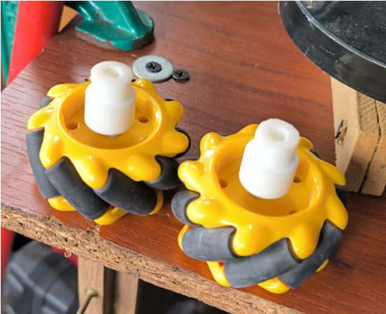
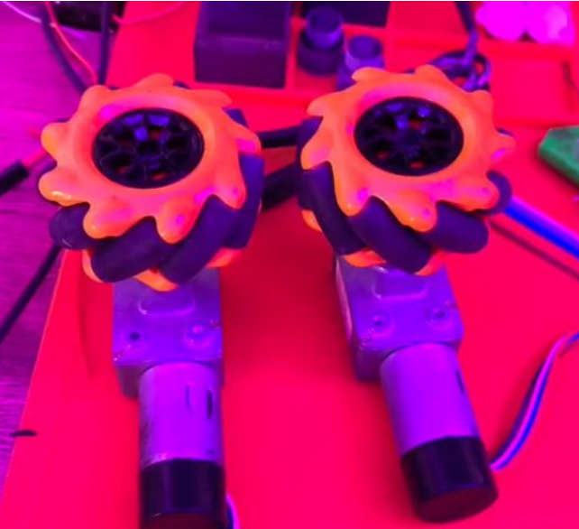
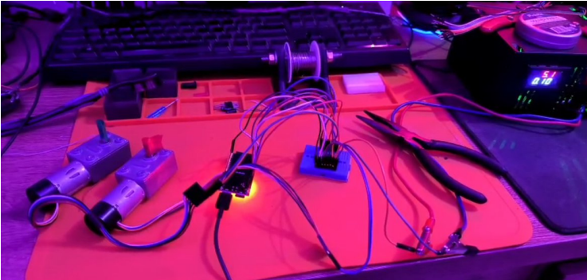
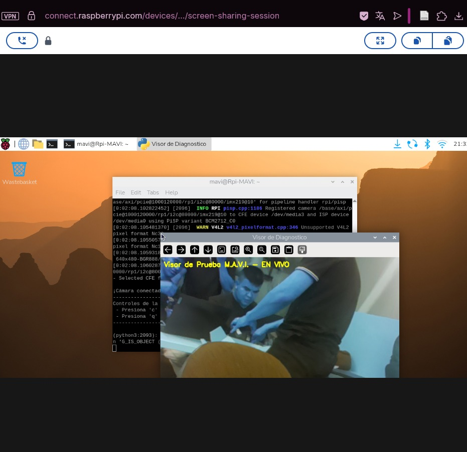
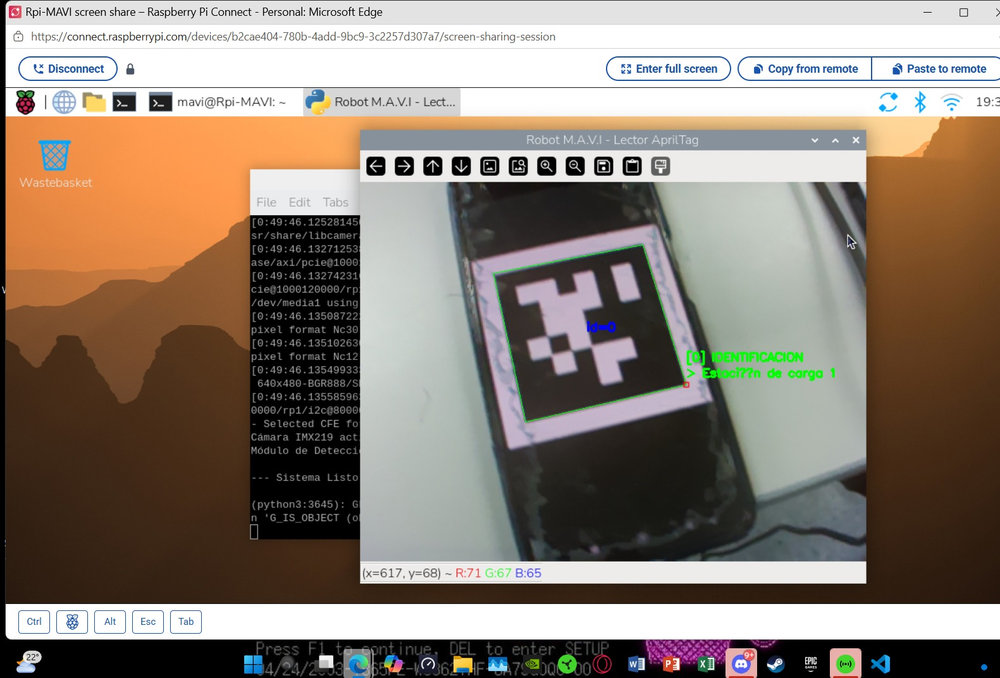
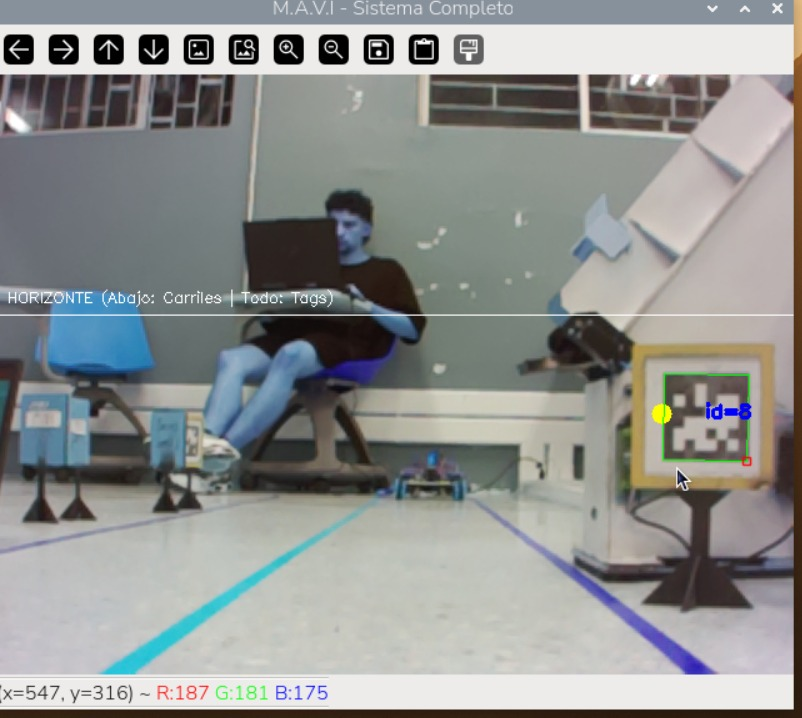
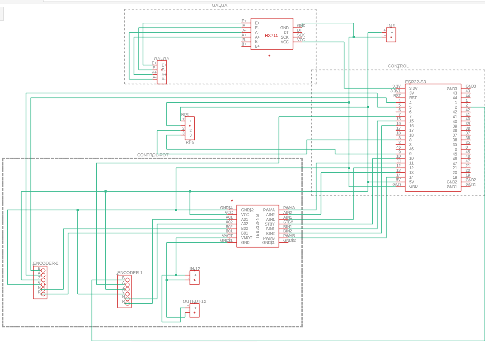
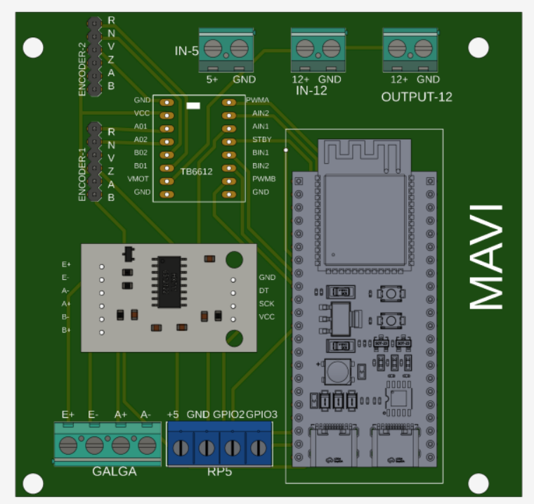
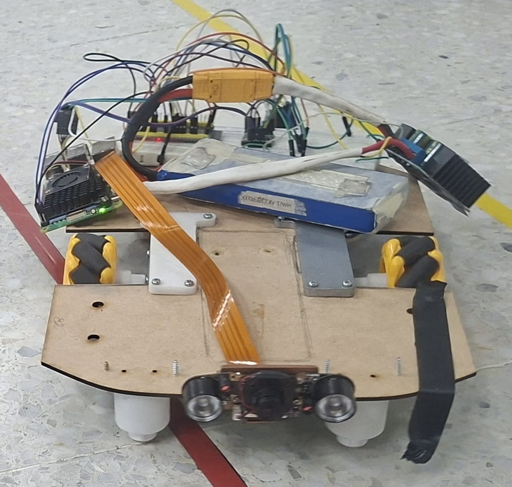

# 📸 Galería de Evidencias — Diseño Electrónico

*Registro técnico y evolutivo de pruebas de laboratorio, prototipado físico, visión artificial, diseño de PCB y arquitectura del sistema de M.A.V.I.*

---

## 🔹 Fase 1: Prototipado Físico Inicial y Manufactura de Acoples
> **Evolución Inicial:** Desde la estructura provisional de pruebas hasta la fabricación aditiva y el ajuste mecánico de componentes.

### 1. 🚚 Chasis Provisional Inicial de Locomoción
> **Estructura:** Base provisional de pruebas · Montaje inicial de tracción

*Estructura provisional ensamblada en las primeras etapas para la ejecución de pruebas preliminares de desplazamiento, geometría y comportamiento básico de tracción.*

### 2. 🖨️ Fabricación de Acoples en Resina (SLA)
> **Proceso:** Impresión 3D en resina fotopolimérica / Curado UV

*Prototipado rápido de adaptadores a medida para la interfaz entre los ejes de los motorreductores y las ruedas Mecanum.*

### 3. 🛠️ Ajuste Mecánico de Tolerancias
> **Herramienta:** Dremel / Mototool de precisión

*Rectificado de tolerancia dimensional en el acople impreso para garantizar concentricidad y minimizar holgura mecánica.*

### 4. ⚙️ Adaptadores y Ruedas Mecanum
> **Componentes:** Ruedas omnidireccionales + Acoples impresos

*Integración física de las ruedas Mecanum con los adaptadores terminados antes de su montaje en los motores.*

### 5. 🔍 Par de Motorreductores y Tracción
> **Vista:** Superior / Simetría de actuadores

*Vista superior de la alineación y simetría del par de motorreductores ensamblados con sus respectivas ruedas de prueba.*

---

## 🔹 Fase 2: Pruebas de Laboratorio y Módulos de Sensores
> **Evolución Intermedia:** Validación del banco de pruebas electrónico y adquisición preliminar de visión artificial.

### 6. ⚡ Banco de Pruebas Electrónico
> **Componentes:** ESP32-S3 · Driver TB6612FNG · Fuente de alimentación (5.1V @ 2A)

*Montaje de laboratorio para la validación de señales PWM, protocolo de comunicación y comportamiento térmico del driver de potencia.*

### 7. 📹 Validación de Cámara IMX219
> **Hardware:** Raspberry Pi 5 · Cámara IMX219-160 (162° FOV)

*Verificación de adquisición de flujo de video en tiempo real, calibración de contraste y ángulo de visión de la cámara instalada.*

### 8. 🏷️ Detección y Lectura de AprilTags
> **Algoritmo:** OpenCV / AprilTag Library

*Validación del algoritmo de procesamiento de imagen para el reconocimiento, identificación de IDs y estimación de pose a partir de AprilTags.*

### 9. 🏁 Reconocimiento de Pista y Entorno
> **Procesamiento:** Visión por computador en Raspberry Pi 5

*Pruebas de adquisición de imagen del entorno de navegación y segmentación de la pista de pruebas para la guía del robot.*

---

## 🔹 Fase 3: Arquitectura, Esquemáticos y Diseño de PCB
> **Evolución Consolidadora:** Formalización del circuito electrónico y trazado de la placa integrada en Fusion 360.

### 10. 📐 Esquemático Electrónico Consolidado
> **Herramienta:** Autodesk Fusion Electronics / Schematics

*Diagrama esquemático consolidado del sistema que integra microcontroladores (ESP32-S3), módulo de procesamiento (Raspberry Pi 5), reguladores de voltaje, etapas de potencia (TB6612FNG) y acondicionado de señal para sensores.*

### 11. 🎛️ Diseño y Render de PCB (Placa de Circuito Impreso)
> **Archivo Integrado:** `mavi_pcb_diseno_integral.f3z` en `/PCB/`

*Vista integral en Autodesk Fusion 360 del esquema, trazado de pistas (layout 2D) y renderizado 3D de la tarjeta de circuito impreso proyectada para la versión consolidada del MVP.*

---

## 🔹 Fase 4: Integración del Sistema Completo y Pruebas Dinámicas
> **Hito Actual / Mayor Crecimiento:** Ensamble físico integral sobre chasis de MDF, integración de hardware y demostración funcional en video.

### 12. 🧩 Ensamble Mecánico y Electrónico Integral sobre MDF
> **Estructura:** Base de MDF optimizada · Ruedas Mecanum · RPi5 · Cámara IMX219 · Batería y Etapa de Potencia

*Vista superior del prototipo físico totalmente integrado. Se aprecia la distribución espacial de la Raspberry Pi 5, el sistema de visión frontal, el paquete de baterías y el cableado de potencia acoplados sobre el chasis de MDF y las ruedas Mecanum.*

### 13. 🎬 Demostración Funcional: Integración de Motores y Cámara
> **Formato:** Video demostrativo (YouTube) · **Componentes:** ESP32-S3 · Driver TB6612FNG · Cámara IMX219 · Motores JGY370

*Demostración en video del diagrama de base de movimiento de motores, adquisición de flujo de video por cámara y respuesta del circuito electrónico integrado durante la ejecución en pista.*

---

[⬅️ Volver a Diseño Electrónico](../README.md)