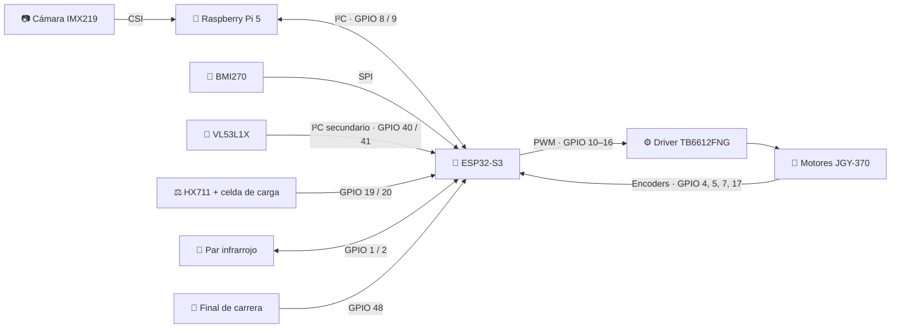
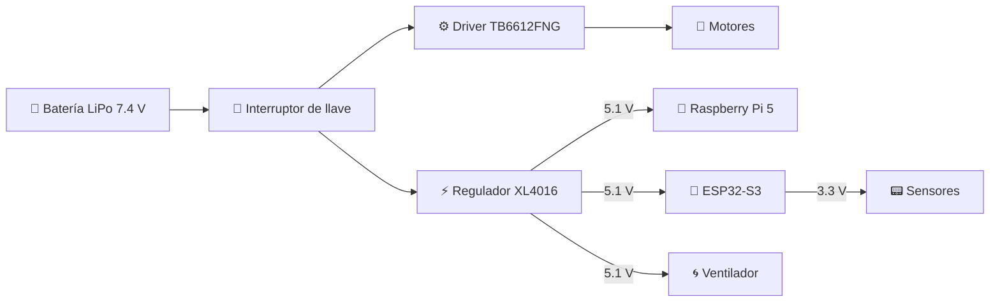

# ⚡ Diseño electrónico

Sistema electrónico de M.A.V.I., integrado en una placa de circuito impreso propia que concentra la distribución de potencia, el control de los motores y la conexión de todos los sensores del vehículo.

PCB de M.A.V.I. fabricada y soldada

---

### 🧠 Arquitectura

El sistema trabaja en dos niveles. La **Raspberry Pi 5** procesa la imagen de la cámara, identifica la pista, los AprilTags y los obstáculos, y decide hacia dónde moverse. La **ESP32-S3** recibe esas órdenes, controla los motores y lee de forma continua los sensores del vehículo.

La asignación completa de pines se encuentra en la [Tabla de conexiones](01_Diagramas_Conexion/Tabla_de_Conexiones.pdf).

---

### 🔋 Alimentación

El sistema maneja tres niveles de voltaje:

- `7.4 V` — Potencia de los motores, entregada por la batería a través del driver.
- `5.1 V` — Raspberry Pi 5, ESP32-S3, lógica del driver y ventilador, a partir del regulador XL4016.
- `3.3 V` — Encoders, BMI270, VL53L1X, HX711 y receptor infrarrojo, desde la ESP32-S3.

---

### 🟩 La placa

`2 capas` `1.6 mm` `99.45 × 118.35 mm` `Máscara negra` `Diseñada en Fusion 360` `Fabricada en JLCPCB`

La PCB reemplaza el cableado en protoboard por conexiones fijas y ordenadas. Cada conector está identificado en la serigrafía de la placa:

- `VOLTAJES` · `IN-5` · `IN-12` · `OUTPUT-12` — Entrada y distribución de potencia.
- `ENCODER-1` · `ENCODER-2` — Encoders de los motores.
- `BMI` · `VL53L1` — Giroscopio y sensor láser.
- `GALGA` — Celda de carga, conectada al módulo HX711.
- `TRASMISOR` · `X1` — Emisor y receptor infrarrojo.
- `JP1` — Conector de 40 pines hacia la Raspberry Pi 5.
- `S1` — Paro de emergencia.

---

### 🧩 Componentes

#### 🧠 Procesamiento
- **Raspberry Pi 5** `8 GB` — Visión artificial y toma de decisiones.
- **ESP32-S3** `N16R8` — Control de motores y lectura de sensores.

#### 🔋 Potencia
- **Batería LiPo** `7.4 V · 5000 mAh` — Fuente de energía del sistema.
- **Interruptor de llave** `ON / OFF` — Encendido general; la llave evita activaciones accidentales.
- **Regulador XL4016** `7.4 V → 5.1 V` — Alimentación de la electrónica de control.
- **Ventilador** `5 V` — Disipa el calor del regulador.

#### ⚙️ Actuadores
- **Driver TB6612FNG** `Puente H doble` — Controla velocidad y sentido de giro de los motores.
- **Motorreductores JGY-370** `6 V · 100 RPM · x2` — Mueven las ruedas; sus encoders miden el giro de cada una.

#### 📟 Sensores
- **Cámara IMX219-160** `8 MP · 162°` — Captura la pista, los AprilTags y los obstáculos.
- **Giroscopio BMI270** `SPI` — Mide giros y aceleraciones del vehículo.
- **Sensor láser VL53L1X** `Hasta 4 m` — Mide la distancia a los obstáculos.
- **Celda de carga + HX711** `3 kg · 24 bits` — Detecta si hay carga sobre la plataforma.
- **Par infrarrojo** `Emisor + receptor` — Intercambio de señales con las estaciones.

#### 🛑 Seguridad
- **Final de carrera** `Parachoques` — Detiene los motores de inmediato ante un impacto.

#### 🔌 Conexión y pasivos
- **Borneras de tornillo** — Sujeción firme de los cables de potencia, la celda de carga y el transmisor.
- **Conectores tipo header** — Conexión de encoders, sensores y Raspberry Pi 5.
- **Resistencia R1** `10 kΩ` — En serie con el emisor infrarrojo, limita su corriente.
- **Resistencia R2** `10 kΩ` — Entre la señal del receptor infrarrojo y tierra, estabiliza la lectura.
- **Trimmer** `Potenciómetro de ajuste` — Regula la corriente del emisor infrarrojo para ajustar la intensidad de la señal.
- **Cable plano con conector IDC** — Comunica la PCB con la Raspberry Pi 5.
- **Cable de potencia de silicona** — Lleva la corriente de la batería al regulador y al driver.

---

### 📂 Contenido de la carpeta

📐 **[01_Diagramas_Conexion](01_Diagramas_Conexion/)** — Árbol de conexiones y tabla de conexiones pin a pin.

🔌 **[02_Esquematico](02_Esquematico/)** — Esquema eléctrico en Fusion 360, formato Eagle y PDF.

🟩 **[03_Diseno_PCB](03_Diseno_PCB/)** — Diseño de la placa, modelo 3D e imágenes renderizadas.

🏭 **[04_Fabricacion](04_Fabricacion/)** — Archivos Gerber y lista de materiales (BOM).

📷 **[05_Evidencias](05_Evidencias/)** — Registro fotográfico de la placa fabricada.

---

### 📊 Estado del módulo

✅ Diagramas y tabla de conexiones · ✅ Esquemático · ✅ Diseño de la PCB · ✅ Fabricación · ✅ Soldadura y pruebas

---

<a href="../README.md">⬅️ Volver al inicio</a>

