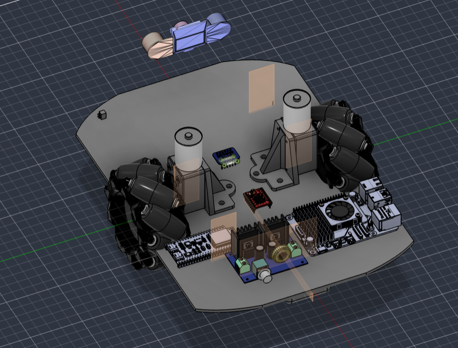
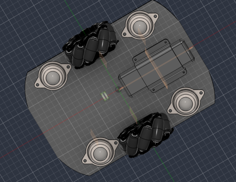

# 📸 Galería de Renders y Evidencias 3D — Diseño Mecánico

*Visualización tridimensional del ensamblaje general y sistemas de tracción del chasis de M.A.V.I. modelado en Autodesk Fusion 360.*

---

### 1. ⚙️ Vista Isométrica Superior (Ensamblaje General)

*Modelado en Autodesk Fusion 360 del ensamblaje general. Muestra la distribución espacial de los componentes electrónicos y el montaje superior de los motores.*

---

### 2. 🔍 Vista Isométrica Inferior (Detalle de Tracción)

*Vista detallada de la parte inferior del chasis. Resalta la integración de las ruedas mecanum y la geometría del mecanismo de tracción para la locomoción omnidireccional.*

---

[⬅️ Volver a Diseño Mecánico](../README.md)