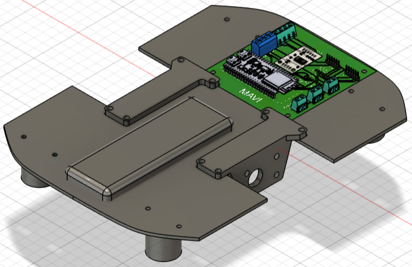
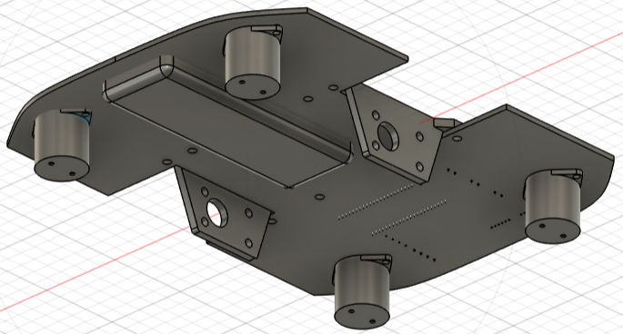
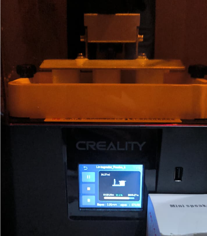
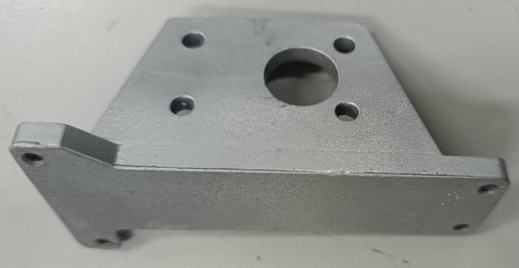
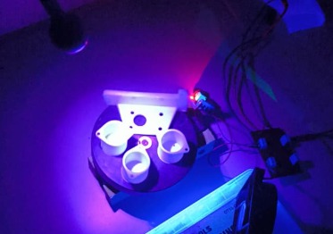
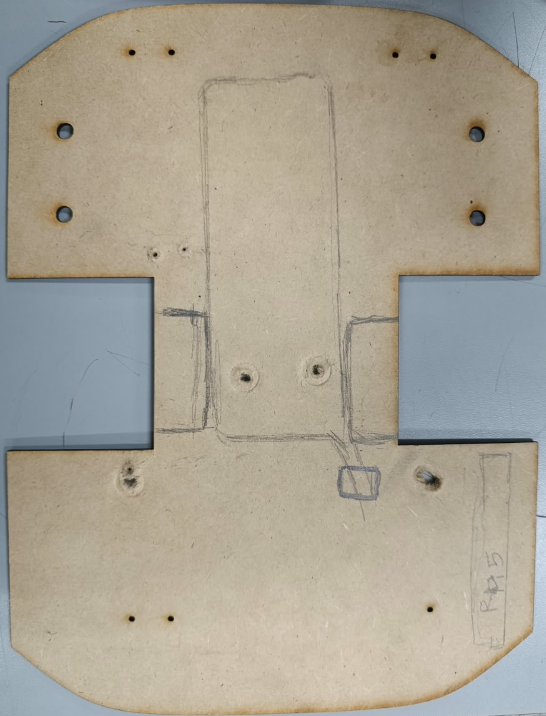
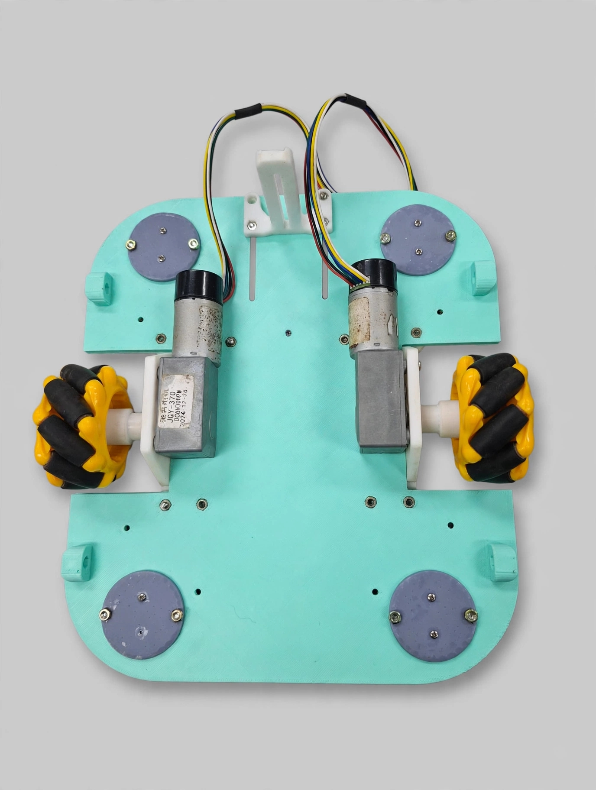

# 📸 Galería de Renders y Evidencias 3D — Diseño Mecánico

*Visualización tridimensional, procesos de fabricación, prototipado físico y validación estructural del chasis de M.A.V.I. modelado en Autodesk Fusion 360.*

---

## 📐 Renders del Diseño CAD (Versión Actualizada / Objetivo)
> **Responsables:** Equipo de Diseño Mecánico (Edwar & Sara)

### 1. ⚙️ Vista Isométrica Superior (Ensamblaje General)

*Modelado en Autodesk Fusion 360 del ensamblaje general actualizado. Muestra la reubicación de la batería, la distribución espacial de los componentes y el montaje superior.*

### 2. 🔍 Vista Isométrica Inferior (Detalle de Tracción)

*Vista detallada de la parte inferior del chasis. Resalta la integración de las dos ruedas Mecanum en tracción diferencial y de las cuatro ruedas locas de balín que dan estabilidad al chasis.*

---

## 🖨️ Prototipado Rápido e Impresión 3D
> **Proceso:** Fabricación aditiva de soportes estructurales

### 3. 🔄 Proceso de Impresión 3D

*Registro del proceso de fabricación aditiva de los componentes mecánicos y soportes del robot.*

### 4. 🛠️ Soportes de Motores

*Vista detallada de los soportes impresos diseñados para el acoplamiento rígido de los motorreductores al chasis principal.*

### 5. ⚪ Soportes de Ruedas Locas de Balín

*Fabricación de los soportes destinados a las ruedas locas, orientados a garantizar estabilidad y distribución uniforme de cargas.*

---

## 🚚 Pruebas Físicas y Validación Preliminar
> **Fase:** Ensamble de pruebas y verificación geométrica

### 6. 🪵 Chasis en MDF para Pruebas Físicas

*Corte en MDF del chasis prototipo para la validación física de dimensiones, tolerancias y encaje preliminar antes de la manufactura definitiva.*

---

## ✅ Resultado del Diseño
> **Fase:** Chasis definitivo tras la validación preliminar

### 7. 🏁 Chasis Definido

*Modelo CAD del chasis definitivo de M.A.V.I. en Autodesk Fusion 360, con la distribución final de la electrónica, la plataforma de dos niveles y el soporte ajustable de la cámara.*

---

## 📄 Documentación Técnica Complementaria
* **[DISEÑO CONCEPTUAL CAD CON LISTADO DE MATERIALES.pdf](../DISEÑO%20CONCEPTUAL%20CAD%20CON%20LISTADO%20DE%20MATERIALES.pdf)**: Documento técnico que detalla la conceptualización del chasis y el listado preliminar de componentes.

---

[⬅️ Volver a Diseño Mecánico](../README.md)