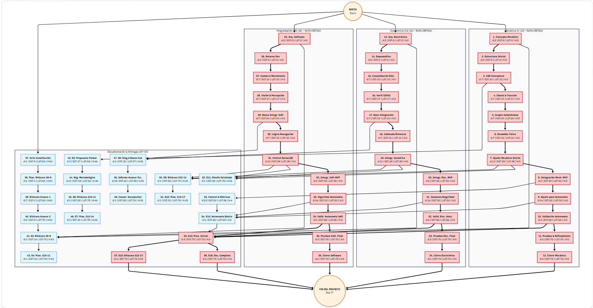

# 📅 Planeación

Planificación temporal del proyecto M.A.V.I., elaborada con el Método de la Ruta Crítica (CPM) bajo los lineamientos de la norma ISO 21500.

`57 actividades` `1.368 horas` `17 hitos` `14 sep – 1 dic 2026`

---

### 📊 Cronograma

 **Diagrama_de_Gantt.xlsx**

Cronograma completo del proyecto en una hoja de cálculo de Microsoft Excel. Organiza las 57 actividades por rol (Mecánica, Electrónica, Programación y Documentación), con su responsable y su duración, y las ubica en el calendario desde septiembre hasta diciembre de 2026. Muestra la distribución de las 1.368 horas de trabajo del equipo y señala los 17 hitos de entrega académica, desde el acta de constitución hasta la sustentación final. Requiere descarga y se abre con Microsoft Excel u otra hoja de cálculo.

---

### 🛤️ Ruta crítica

 **Ruta_Critica_CPM.png**

Red de precedencias del proyecto, construida con el lenguaje Mermaid. Representa las 57 actividades como nodos conectados según el orden en que deben ejecutarse. Cada nodo indica su duración (*d*), su inicio más temprano (*EST*), su inicio más tardío (*LST*) y su holgura total (*H*). Las actividades con holgura cero conforman la ruta crítica: cualquier retraso en ellas retrasa la entrega final del proyecto. Se visualiza directamente en GitHub.

---

<a href="../README.md">⬅️ Volver a Documentación</a>

