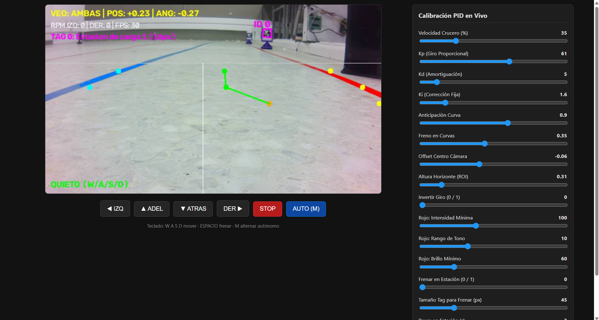
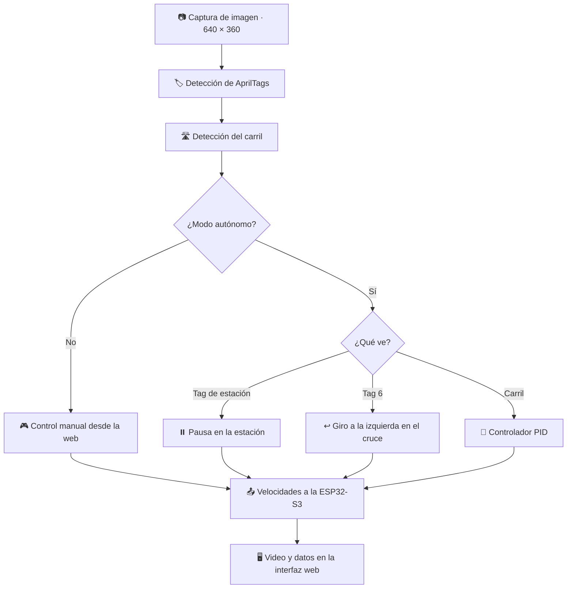

<div align="center">

# 🍓 Raspberry Pi 5 — Visión y navegación


Software de alto nivel de M.A.V.I. Procesa en tiempo real la imagen de la cámara para seguir el carril y reconocer las estaciones mediante AprilTags, calcula la velocidad de cada rueda con un controlador PID y envía las órdenes a la ESP32-S3 por I²C. Incluye una interfaz web para supervisar, controlar y calibrar el vehículo desde cualquier navegador.



<sub>Interfaz web de control y calibración</sub>

</div>

---

### 🔄 Funcionamiento



---

### ✨ Funcionalidades

#### 🛣️ Seguimiento del carril
La imagen se analiza en ocho franjas horizontales, de la más cercana a la más lejana. En cada una se identifica la línea **azul**, a la izquierda, y la **roja**, a la derecha, para calcular el centro del carril. Cuando solo una de las líneas es visible, la posición de la otra se estima a partir del ancho del carril aprendido durante el recorrido. Este método permite seguir las curvas y descartar manchas de color que no corresponden a la pista, como manos o ropa.

#### 🎯 Controlador PID
A partir de la desviación del vehículo respecto al centro del carril y del ángulo de la curva que se aproxima, el controlador calcula la velocidad de cada rueda. Reduce la velocidad en las curvas cerradas y limita el giro máximo según las medidas reales del vehículo y de la pista, para evitar oscilaciones.

#### 🏷️ Reconocimiento de AprilTags
Detecta marcadores de la familia `tag36h11` en toda la imagen. Cada identificador tiene un significado dentro de la pista:

- `0` `1` — Estaciones de carga 1 y 2.
- `2` `3` `4` `5` — Estaciones de descarga 1 a 4.
- `6` — Descargas 3 y 4 hacia la izquierda.
- `7` — Giro obligatorio a la izquierda.
- `8` `9` `10` `11` — Ir a las descargas 1 a 4.
- `12` `13` — Ir a las estaciones de carga 2 y 1.

Al llegar a una estación, el vehículo puede detenerse durante un tiempo configurable. Al detectar el tag `6`, se prepara para girar a la izquierda en el siguiente cruce y retoma el carril nuevo al encontrarlo.

#### 🖥️ Interfaz web
Disponible en el puerto `5000` de la Raspberry Pi 5. Muestra el video de la cámara con la información del sistema superpuesta (líneas detectadas, centro del carril, tags, velocidad de los motores y estado), y permite:

- Mover el vehículo en modo manual con `W` `A` `S` `D`, frenar con `Espacio` y alternar el modo autónomo con `M`.
- Ajustar en vivo los parámetros de navegación mediante deslizadores, guardarlos o restaurar los valores por defecto.

#### 🛑 Seguridad
- Si la interfaz web deja de comunicarse durante 5 segundos, el vehículo se detiene.
- Si el carril se pierde durante varias imágenes seguidas, el vehículo frena.
- Al cerrar el programa, los motores se detienen y el sistema de movimiento se apaga.

---

### 🎚️ Parámetros calibrables

Los parámetros se ajustan desde la interfaz web y se guardan en `calibracion_mavi.json`:

- **Movimiento** — Velocidad de crucero, velocidad manual y balance entre motores.
- **Controlador PID** — Ganancias `Kp`, `Ki` y `Kd`, anticipación de curva, freno en curvas y tope de giro.
- **Visión** — Altura de la zona analizada, desplazamiento del centro y rango de detección del color rojo.
- **AprilTags** — Parada en estaciones, distancia de parada y duración de la pausa.
- **Cruce** — Distancia de preparación, espera antes del giro, tiempo máximo de giro y velocidad de la rueda interior.

---

### 📄 Archivos

 **mavi_carril_tags.py**

Programa principal. Está organizado en siete secciones: comunicación I²C con la ESP32-S3, parámetros calibrables, visión por computador, controlador PID, gestión de AprilTags y del cruce, servidor de la interfaz web y bucle principal. Se ejecuta en la Raspberry Pi 5.

 **calibracion_mavi.json**

Valores de calibración con los que opera el vehículo en la pista. El programa lo crea al presionar *Guardar* en la interfaz web y lo carga automáticamente al iniciar. Se visualiza directamente en GitHub.

 **requirements.txt**

Lista de las librerías de Python que requiere el programa: NumPy, OpenCV, smbus2, Flask y Picamera2. Se visualiza directamente en GitHub.

 **interfaz_web.png**

Captura de la interfaz web durante la operación del vehículo. Se visualiza directamente en GitHub.

---

### 🚀 Ejecución

**1.** Habilitar la comunicación I²C en la Raspberry Pi 5 desde `sudo raspi-config` → *Interface Options* → *I2C*.

**2.** Instalar las librerías:

```bash
pip install -r requirements.txt
```

**3.** Ejecutar el programa:

```bash
python3 mavi_carril_tags.py
```

**4.** Abrir la interfaz web desde un navegador conectado a la misma red: `http://<IP-de-la-Raspberry>:5000`

La comunicación con la ESP32-S3 sigue el [Mapa de registros I²C](../Mapa_de_Registros_I2C.md).

---

<div align="center">
<sub><a href="../README.md">⬅️ Volver a src</a></sub>
</div>