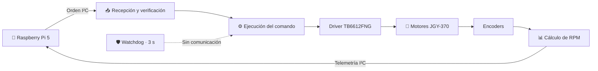

# 🧠 ESP32-S3 — Control de bajo nivel

Firmware de la ESP32-S3 de M.A.V.I. Recibe por I²C las órdenes de la Raspberry Pi 5, controla la velocidad y el sentido de giro de los dos motores, mide su velocidad real con los encoders y devuelve esa información como telemetría. Incluye un sistema de vigilancia que detiene el vehículo si se pierde la comunicación.

---

### 🔄 Funcionamiento

---

### ✨ Funcionalidades

#### 📥 Recepción de órdenes
La ESP32-S3 funciona como esclavo I²C en la dirección `0x08`. Cada mensaje recibido se verifica con su byte de control antes de ejecutarse; si llega dañado, se descarta y se reporta el error en la telemetría. Atiende tres tipos de orden:

- **Registro 1** `Encendido` — Detiene los motores al iniciar o finalizar el programa de la Raspberry Pi 5.
- **Registro 2** `Dirección` — Movimientos predefinidos: quieto, adelante, atrás, izquierda y derecha.
- **Registro 3** `Velocidades` — Velocidad independiente para cada rueda, entre `-100 %` y `100 %`. Es la orden que utiliza el controlador PID durante la navegación autónoma.

Las órdenes se guardan en una cola protegida y se ejecutan desde el ciclo principal, lo que evita conflictos entre la comunicación y el control de los motores.

#### ⚙️ Control de motores
La velocidad se controla mediante señales PWM de `20 kHz` y `8 bits` enviadas al driver TB6612FNG. El porcentaje recibido se convierte en un valor de PWM que parte de un mínimo de `60`, para que los motores venzan la fricción incluso a velocidades bajas. Un factor de compensación iguala la respuesta de ambos motores, y el sentido de giro de cada rueda se asigna según su posición física en el vehículo.

#### 📊 Medición de velocidad
Los encoders de los motores generan `1981 pulsos por vuelta`. La ESP32-S3 los cuenta mediante interrupciones, con un filtro que descarta pulsos falsos por ruido. Cada 100 ms calcula las revoluciones por minuto (RPM) de cada rueda, promedia cinco mediciones y pone el resultado a disposición de la Raspberry Pi 5.

#### 🛡️ Vigilancia de la conexión
Si transcurren `3 segundos` sin comunicación con la Raspberry Pi 5, ya sea porque aún está iniciando o porque se perdió la conexión, la ESP32-S3 detiene los motores y reinicia el bus I²C para restablecer el enlace.

---

### 📌 Pines utilizados

- **I²C** — `SDA: GPIO 9` · `SCL: GPIO 8`
- **Driver TB6612FNG** — `STBY: GPIO 10` · Motor A `PWMA: 11` `AIN1: 12` `AIN2: 13` · Motor B `PWMB: 14` `BIN1: 15` `BIN2: 16`
- **Encoder 1** — `Canal A: GPIO 5` · `Canal B: GPIO 4`
- **Encoder 2** — `Canal A: GPIO 17` · `Canal B: GPIO 7`

La conexión completa del sistema se encuentra en la [Tabla de conexiones](../../diseño%20electrónico/01_Diagramas_Conexion/Tabla_de_Conexiones.pdf).

---

### 🔜 Integraciones previstas

El hardware de los siguientes sensores ya se encuentra en la PCB; su integración al firmware se realizará una vez instalados sus soportes en el vehículo:

- **Giroscopio BMI270** — Medición de giros y aceleraciones.
- **Sensor láser VL53L1X** — Medición de distancia a obstáculos.
- **Celda de carga y HX711** — Detección de carga sobre la plataforma.
- **Par infrarrojo** — Comunicación con las estaciones.
- **Final de carrera** — Paro de emergencia ante impactos.

---

### 📄 Archivos

 **esp32_robot_i2c/esp32_robot_i2c.ino**

Programa completo de la ESP32-S3, escrito en C++ con el entorno Arduino. Está organizado en nueve secciones: configuración I²C, pines, parámetros de potencia, variables de estado, interrupciones de encoders, control de motores, comunicación I²C, ejecución de comandos y cálculo de RPM, y ciclo principal.

---

### 🚀 Carga del programa

**1.** Instalar el [Arduino IDE](https://www.arduino.cc/en/software) y agregar el soporte para placas ESP32 de Espressif (versión 3.x).

**2.** Abrir `esp32_robot_i2c.ino` y seleccionar la placa **ESP32S3 Dev Module**.

**3.** Conectar la ESP32-S3 al computador por el puerto USB COM y cargar el programa.

La comunicación con la Raspberry Pi 5 sigue el [Mapa de registros I²C](../Mapa_de_Registros_I2C.md).

---

<a href="../README.md">⬅️ Volver a src</a>

