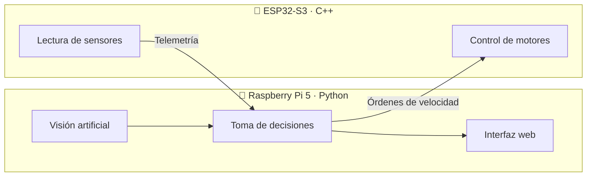

# 💻 Software

Código fuente de M.A.V.I. El software se divide entre dos tarjetas que trabajan de forma coordinada: la Raspberry Pi 5, encargada de la visión artificial y la toma de decisiones, y la ESP32-S3, responsable del control de los motores y la lectura de los sensores.

---

### 🧠 Arquitectura

La **Raspberry Pi 5** actúa como maestro: analiza la imagen de la cámara, decide cómo debe moverse el vehículo y envía las órdenes. La **ESP32-S3** actúa como esclavo: ejecuta esas órdenes sobre los motores y devuelve información del estado del vehículo, como la velocidad medida por los encoders.

Ambas tarjetas se comunican por I²C siguiendo un protocolo propio, documentado en el [Mapa de registros I²C](Mapa_de_Registros_I2C.md).

---

### 📂 Contenido de la carpeta

🍓 **[01_Raspberry_Pi](01_Raspberry_Pi/)** — Programa principal de visión y navegación: seguimiento del carril, controlador PID, reconocimiento de AprilTags e interfaz web de control y calibración.

🔗 **[Mapa_de_Registros_I2C.md](Mapa_de_Registros_I2C.md)** — Protocolo de comunicación entre la Raspberry Pi 5 y la ESP32-S3: estructura de los mensajes, registros disponibles y verificación de datos.

---

### ✨ Funcionalidades implementadas

✅ Seguimiento del carril azul y rojo mediante visión artificial
✅ Control de trayectoria con controlador PID
✅ Reconocimiento de AprilTags para identificar estaciones y cruces
✅ Parada en estaciones y giro en cruces según el tag detectado
✅ Interfaz web con video en vivo, control manual y calibración de parámetros
✅ Comunicación I²C con verificación de mensajes
✅ Frenado de seguridad ante pérdida del carril o de la conexión

---

### 🛠️ Tecnologías

- **Python** `Raspberry Pi 5` — Lenguaje del programa de visión y navegación.
- **OpenCV** `Visión artificial` — Procesamiento de imagen y detección de AprilTags.
- **Flask** `Servidor web` — Interfaz de control y calibración desde el navegador.
- **C++ / Arduino** `ESP32-S3` — Firmware de control de bajo nivel.
- **smbus2** `I²C` — Comunicación entre la Raspberry Pi 5 y la ESP32-S3.

---

<a href="../README.md">⬅️ Volver al inicio</a>

